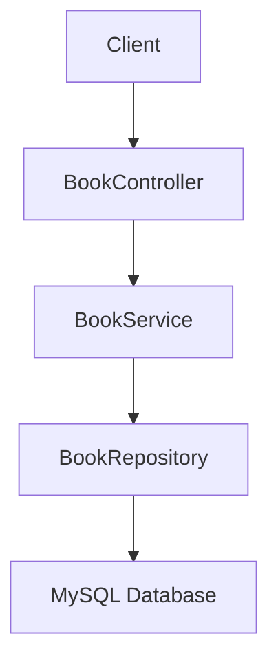

# Self-Help Books API

A Spring Boot REST API for browsing and searching a catalogue of self-help books, backed by MySQL.

**Tech:** Java 21 · Spring Boot · Spring Data JPA · MySQL · JUnit 5 · Mockito · Lombok/SLF4J

## Running Instructions:

### Data Set Up
1. Install MySQL
2. Run SQL in `src/main/resources/schema.sql` in MySQL Workbench

3. Edit  `src/main/resources/application.yml`:
- Change `password` to your MySQL password

### Run Application
Java 21 required to run project
```bash
mvn spring-boot:run
```
Application runs on: http://localhost:8080

**Get all books:**
```
GET /api/books
```

**Search by category (query param):**
```
GET /api/books?category=Productivity
```

**Get by category (path variable):**
```
GET /api/books/Mindfulness
```

**Add new book:**
```
POST /api/books
Content-Type: application/json

{
  "title": "Atomic Habits",
  "author": "James Clear",
  "category": "Productivity",
  "price": 16.99
}
```

## Flow Diagram


## Features

### Testing
- Comprehensive unit tests for BookController
- Tests cover valid inputs, invalid inputs, and boundary cases
- **Run tests in IntelliJ**: Right-click `BookControllerTest.java` → Run
- **Run tests in terminal**: `./mvnw test` (Mac/Linux) or `mvnw.cmd test` (Windows)

### Advanced Java Features
- **Streams**: Filter books by maximum price using `.filter()` in `BookService.getBooksByMaxPrice()`
- **Exceptions**: Custom `BookNotFoundException` thrown in method signature with try-catch handling in `BookService`
- **Generics**: `ApiResponse<T>` generic wrapper class for all API responses
- **Logging**: @Slf4j used throughout with INFO, DEBUG, and ERROR levels

### New Endpoints

**Filter books by maximum price:**
```bash
GET /api/books?maxPrice=15.00

# Example:
curl "http://localhost:8080/api/books?maxPrice=15.00"
```

**Get book by ID:**
```bash
GET /api/books/{id}

# Example (success):
curl http://localhost:8080/api/books/1

# Example (not found - throws exception):
curl http://localhost:8080/api/books/999
```

**Filter by category:**
```bash
GET /api/books?category=Productivity

# Example:
curl "http://localhost:8080/api/books?category=Productivity"
```

### Response Format
All endpoints now return a generic `ApiResponse<T>` wrapper:
```json
{
  "success": true,
  "message": "Success",
  "data": [...]
}
```

Error responses:
```json
{
  "success": false,
  "message": "Book not found with id: 999",
  "data": null
}
```

Built by Temi Oyelade

